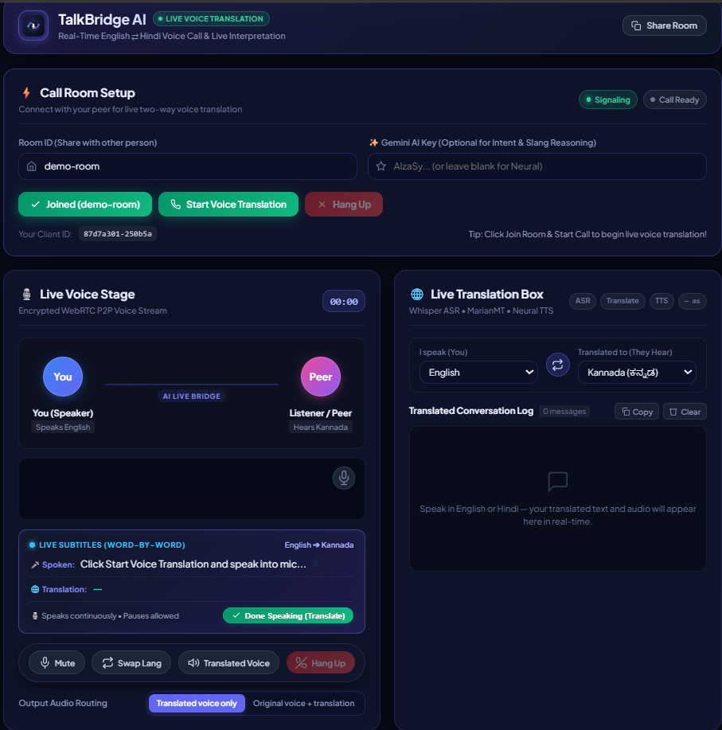
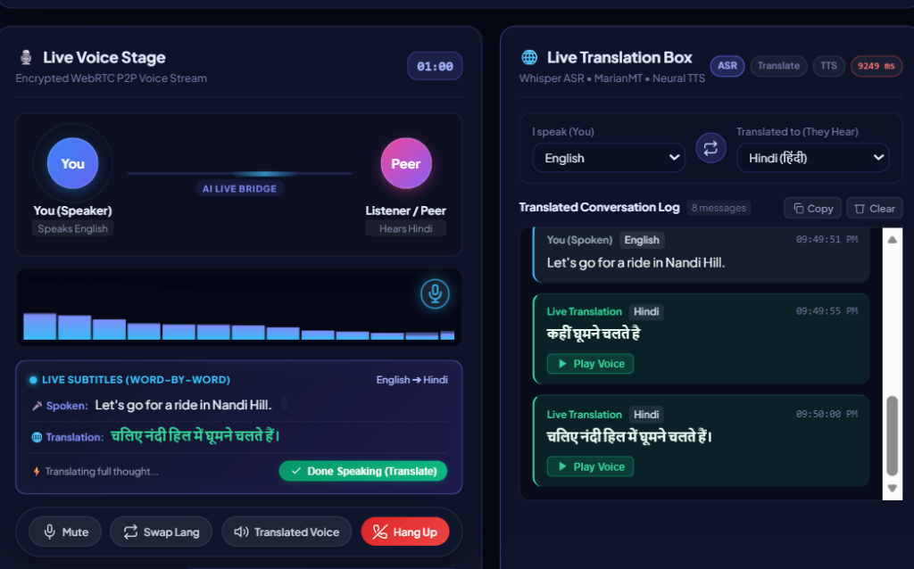
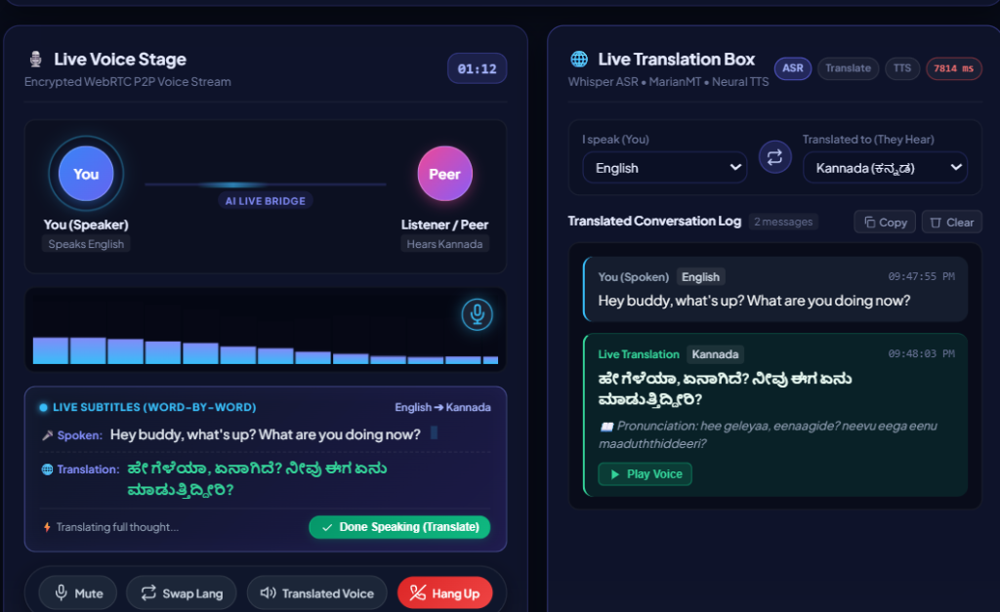
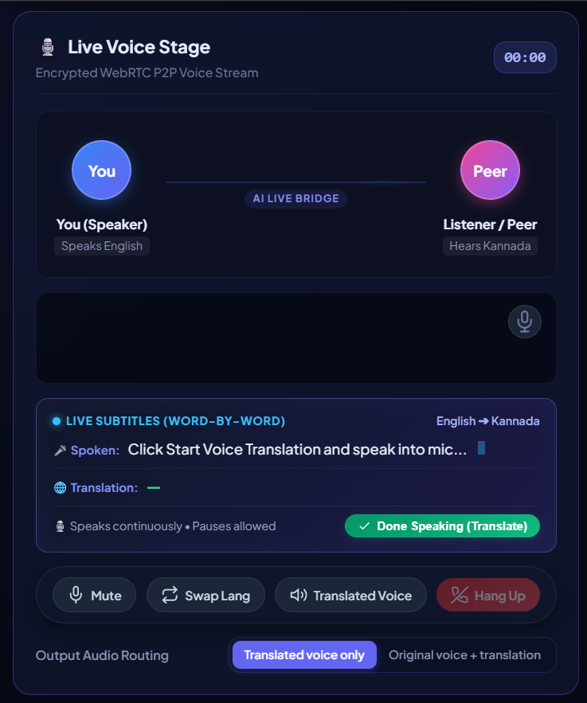

# TalkBridge AI — Real-Time Multilingual Voice Calling & Translation App

**TalkBridge AI** is an end-to-end real-time communication and live translation calling application. It enables two users speaking different languages (**English, Hindi, and Kannada**) to have natural, low-latency voice calls with **instant word-by-word streaming subtitles**, **phonetic Romanized pronunciation guides**, and **gentle, peaceful female neural voice synthesis**.

---

## 📸 Application Screenshots

| Main Dashboard & Call Setup | Live English ➔ Hindi Translation |
| :---: | :---: |
|  |  |

| Live English ➔ Kannada with Pronunciation Guide | Live Voice Stage & Visualizer |
| :---: | :---: |
|  |  |

---

## 🌟 Key Features

1. **Native Calling App Interface**:
   - Installable as a standalone desktop/mobile app (PWA).
   - Real-time audio waveform visualizer with caller voice pulse rings.
   - Floating call action dock (Mute/Unmute Mic, Language Swap, Audio Routing, Hang Up).
2. **Instant Word-by-Word Live Subtitles**:
   - Real-time continuous speech captioning as the speaker talks.
   - Dual-language subtitle strip showing original speech alongside live translation.
3. **Multilingual Bidirectional Support**:
   - Supported languages: **English**, **Hindi (हिंदी)**, and **Kannada (ಕನ್ನಡ)**.
   - Automatic Romanized pronunciation guides for non-Latin scripts (e.g. Kannada).
4. **Pleasant Female Neural Voices**:
   - High-fidelity, peaceful female voices powered by Edge Neural TTS (`kn-IN-SapnaNeural`, `hi-IN-SwaraNeural`, `en-IN-NeerjaNeural`).
   - Hardware-level echo cancellation and post-speech cooldown to eliminate feedback.
5. **Low-Latency Neural Speech Pipeline**:
   - **ASR**: OpenAI Whisper & Continuous Web Speech Engine.
   - **Translation**: High-speed Neural MarianMT / Intent-aware Gemini 1.5 Flash fallback.
   - **TTS**: Low-latency neural voice synthesis with bounded LRU phrase caching.
   - **VAD**: WebRTC Voice Activity Detector with 1.5-second natural paragraph pause detection.
6. **Encrypted WebRTC P2P Audio**:
   - Direct encrypted media streaming paired with WebSocket room signaling.

---

## 🚀 Quickstart

### 1. Launch with One Command (Standalone App Mode)

From the project root:

```bash
python run_app.py
```
*This starts the FastAPI backend and automatically launches TalkBridge in a dedicated native desktop window.*

---

### 2. Standard Web Mode

**Start Backend:**
```bash
cd backend
python -m uvicorn app.main:app --reload --port 8000
```

**Open App in Browser:**
Navigate to [http://localhost:8000](http://localhost:8000) (Chrome / Edge recommended).

---

## 📲 How to Test a Real-Time Two-Way Call

1. Open [http://localhost:8000](http://localhost:8000) in **Tab 1** (or Device 1).
2. Open [http://localhost:8000](http://localhost:8000) in **Tab 2** (or Device 2).
3. On both tabs:
   - Keep the same **Room ID** (e.g. `demo-room`).
   - Tab 1: Set *"I speak"* to **English 🇬🇧**.
   - Tab 2: Set *"I speak"* to **Hindi 🇮🇳**.
4. Click **Join Room** on both tabs, then click **Start Call** on Tab 1.
5. Speak into your microphone:
   - Words stream **live on screen in real time**.
   - When you finish speaking, the translated Hindi audio will play on Tab 2 and the conversation log will update!

---

## 📦 Project Architecture

```
├── frontend/
│   ├── index.html        # App structure, caller stage, subtitle bar & dock
│   ├── styles.css        # Glassmorphism calling app styling & animations
│   ├── app.js            # WebRTC, WebSocket streaming & Web Speech engine
│   ├── manifest.json     # PWA app configuration (Standalone window)
│   ├── sw.js             # Service Worker cache shell
│   └── icon.svg          # App icon
├── backend/
│   ├── app/
│   │   ├── main.py       # FastAPI application & startup model warmup
│   │   ├── routers/      # Signaling & streaming endpoints
│   │   ├── pipeline/     # VAD segmentation & staged async workers
│   │   └── modules/      # Whisper ASR, MarianMT, TTS & DSP
│   └── requirements.txt
└── run_app.py            # Desktop app launcher script
```
